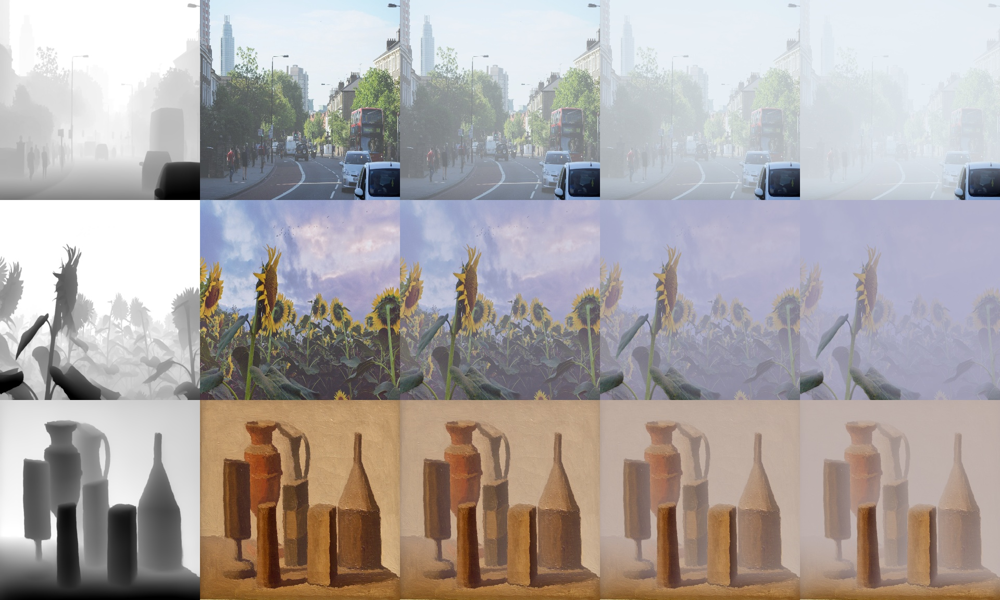

# Foggy – Sinh ảnh sương mù từ bản đồ độ sâu

Tạo ảnh sương mù tổng hợp, chân thực cho ảnh độ phân giải cao (mặc định **2048×2048**) bằng cách kết hợp:

- **Bản đồ độ sâu** ước lượng bởi [Depth Anything V2](https://github.com/DepthAnything/Depth-Anything-V2)
- **Mô hình tán xạ khí quyển** (Koschmieder) với hệ số tán xạ `alpha` điều chỉnh được



*Từ trái sang phải: bản đồ độ sâu (trắng = xa), `alpha` = 0.5, 1, 2, 3 (`--A auto`).*

## Nguyên lý

```
I(x) = J(x) · t(x) + A · (1 − t(x))
t(x) = exp(−alpha · d(x))
```

| Ký hiệu | Ý nghĩa |
|---|---|
| `J(x)` | Ảnh gốc (sạch) |
| `I(x)` | Ảnh sương mù đầu ra |
| `d(x)` | Độ sâu chuẩn hoá về [0, 1] (0 = gần, 1 = xa nhất) |
| `t(x)` | Transmission – tỉ lệ ánh sáng đi qua lớp sương |
| `alpha` | Hệ số tán xạ – càng lớn sương càng dày |
| `A` | Ánh sáng khí quyển – màu/độ sáng của sương |

Depth Anything V2 trả ra disparity tương đối (giá trị lớn = gần), nên script đảo ngược và chuẩn hoá theo percentile 0.5–99.5% để loại outlier, sau đó làm mịn nhẹ để tránh viền răng cưa khi upsample lên 2048×2048. Vì vậy vật ở gần vẫn rõ, cảnh ở xa và bầu trời bị sương phủ dày hơn.

## Cài đặt

```bash
git clone https://github.com/hung20012004/foggy.git
cd foggy
pip install -r requirements.txt
```

Checkpoint Depth Anything V2 được **tự động tải** từ HuggingFace vào `Depth-Anything-V2/checkpoints/` ở lần chạy đầu (vitl ~1.3 GB, vits ~100 MB). Có thể tải thủ công:

| Encoder | Checkpoint |
|---|---|
| `vits` | [depth_anything_v2_vits.pth](https://huggingface.co/depth-anything/Depth-Anything-V2-Small/resolve/main/depth_anything_v2_vits.pth) |
| `vitb` | [depth_anything_v2_vitb.pth](https://huggingface.co/depth-anything/Depth-Anything-V2-Base/resolve/main/depth_anything_v2_vitb.pth) |
| `vitl` | [depth_anything_v2_vitl.pth](https://huggingface.co/depth-anything/Depth-Anything-V2-Large/resolve/main/depth_anything_v2_vitl.pth) |

## Sử dụng

```bash
# Một ảnh, một mức sương
python fog_depth.py --img-path examples/demo01.jpg --alpha 1.5

# Cả thư mục, nhiều mức alpha, tự ước lượng màu sương, lưu thêm depth/transmission
python fog_depth.py --img-path examples --outdir fog_out --alpha 0.5 1 2 3 --A auto --save-depth

# Sương màu xám lạnh (B,G,R), lan vào gần camera hơn
python fog_depth.py --img-path examples --alpha 2 --A 0.85,0.82,0.78 --depth-gamma 0.7
```

### Tham số

| Tham số | Mặc định | Ý nghĩa |
|---|---|---|
| `--img-path` | *(bắt buộc)* | Ảnh hoặc thư mục ảnh (quét đệ quy) |
| `--outdir` | `fog_out` | Thư mục lưu kết quả |
| `--alpha` | `1.0` | Hệ số tán xạ, truyền được nhiều giá trị. ~0.5 nhẹ, 1–2 vừa, ≥3 rất dày |
| `--A` | `0.9` | Ánh sáng khí quyển: một số trong [0,1], ba số `B,G,R`, hoặc `auto` (trung bình các pixel ở vùng xa nhất) |
| `--depth-gamma` | `1.0` | `< 1`: sương lan vào gần camera hơn; `> 1`: sương dồn ra xa |
| `--size` | `2048` | Resize ảnh về `size × size`; `0` = giữ kích thước gốc |
| `--input-size` | `1036` | Độ phân giải đưa vào Depth Anything (bội số của 14). `518` nhanh hơn, `1036` chi tiết hơn |
| `--encoder` | `vitl` | `vits` / `vitb` / `vitl` |
| `--save-depth` | tắt | Lưu thêm bản đồ độ sâu và transmission |

### Đầu ra

| File | Nội dung |
|---|---|
| `<tên>_fog_a<alpha>.png` | Ảnh sương mù |
| `<tên>_depth.png` | Bản đồ độ sâu (trắng = xa), khi có `--save-depth` |
| `<tên>_trans_a<alpha>.png` | Transmission `t(x)`, khi có `--save-depth` |

## Dùng trong code

```python
import cv2, torch
from fog_depth import load_depth_model, estimate_depth, add_fog

model = load_depth_model('vitl', 'cuda' if torch.cuda.is_available() else 'cpu')
img = cv2.resize(cv2.imread('examples/demo01.jpg'), (2048, 2048))
depth = estimate_depth(model, img, input_size=1036)   # [0,1], 1 = xa
fog, t = add_fog(img, depth, alpha=2.0, A=0.9)
cv2.imwrite('fog.png', fog)
```

Ước lượng độ sâu một lần rồi gọi `add_fog` với nhiều `alpha`/`A` khác nhau để sinh nhanh nhiều mức sương.

## Cấu trúc

```
foggy/
├── fog_depth.py          # Script sinh sương mù
├── Depth-Anything-V2/    # Mã nguồn Depth Anything V2 (bản gốc, đã bỏ assets)
├── examples/             # Ảnh mẫu
├── docs/demo.jpg         # Ảnh minh hoạ
└── requirements.txt
```

## Ghi nhận

- [Depth Anything V2](https://github.com/DepthAnything/Depth-Anything-V2) – Yang et al., 2024. Mã nguồn Apache-2.0; checkpoint `vits` Apache-2.0, `vitb`/`vitl` CC-BY-NC-4.0 (chỉ dùng phi thương mại).
